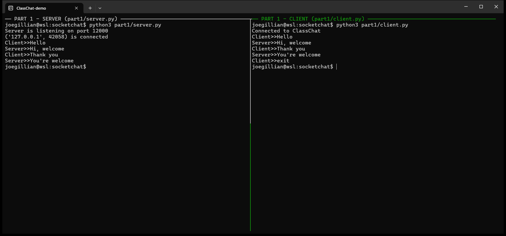
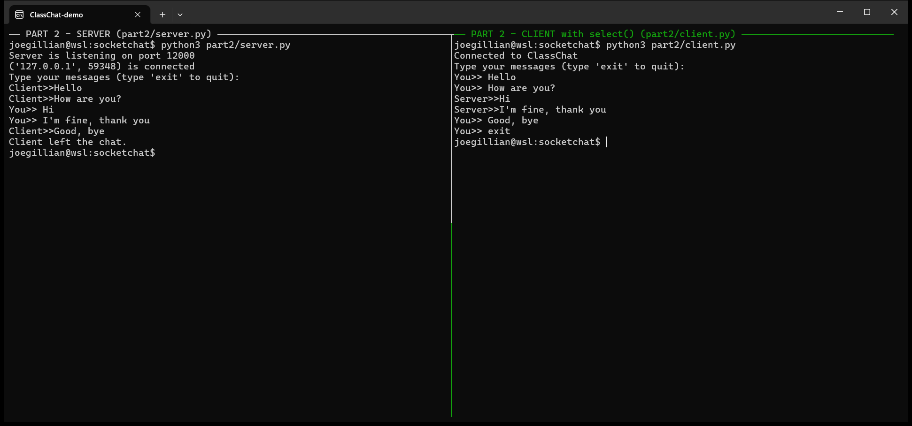
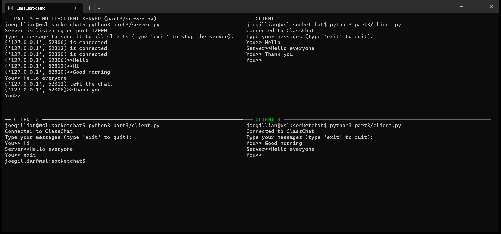
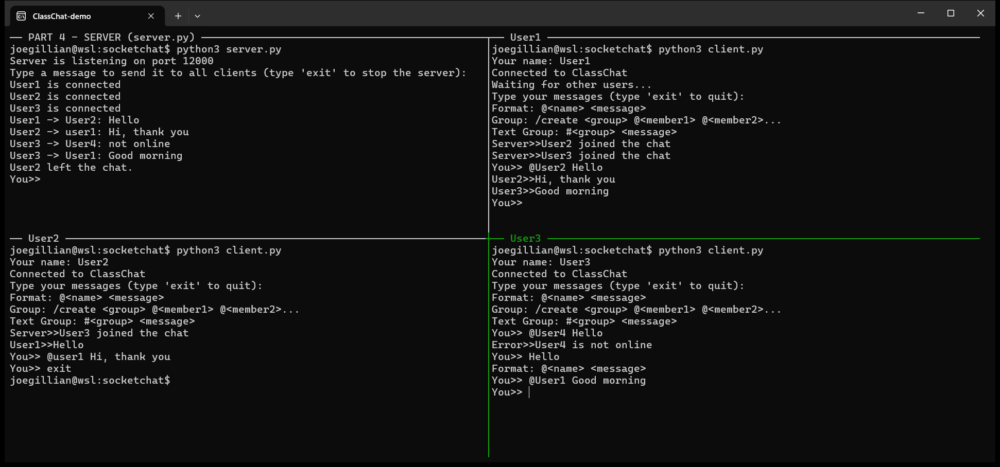
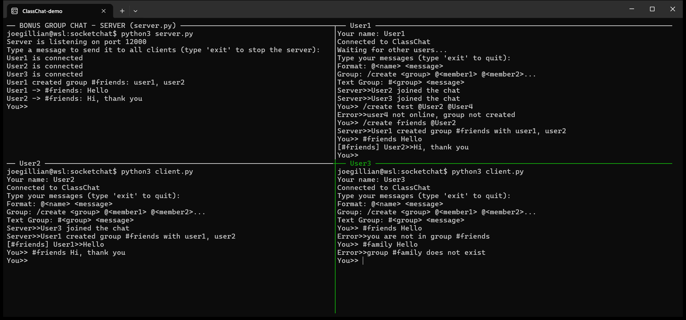

# ClassChat — Technical Report

Course: CSCE 513 — Computer Networking
Student: Sabri Kahoul (C00592933)

---

Yes, I named my semester project "ClassChat", not really original...

For this project I made a central server that accepts several clients and relays their messages. Users can talk to the server, send private messages to each other and chat in groups.

- Language: Python 3 because it was easier for me, with only the standard library (socket, select, sys, json)
- Interface: everything runs in the command line
- Environment: I used WSL because the client and the server use `select()` to watch the keyboard and the sockets, and `select()` on the keyboard doesn't work in a normal Windows terminal
- Port: 12000 on 127.0.0.1 for the demos

I built the project step by step. The final code is `server.py` and `client.py` and I kept the code of parts 1 to 3 in the Archive folder.

---

## Part 1 – Client–Server Communication using TCP/IP

Server
- Creates a TCP socket over IPv4 with `socket(AF_INET, SOCK_STREAM)`
- `bind()` on port 12000, then `listen()` and `accept()` to wait for a client
- When a client connects the server sends an ACK "Connected to ClassChat"

Client
- Creates the same kind of socket and calls `connect()` with the server IP and port
- Prints the ACK it gets from the server

How it works

The client and the server talk in turns. The client sends a message with `send()`, the server gets it with `recv()` and then replies.
If the client types `exit` or closes the window, the connection ends on both sides.

The problem with this version is that you have to wait for the other side to answer before sending something again. That's what part 2 fixes.



---

## Part 2 – Client with select()

To send and receive at the same time the client uses `select.select([sys.stdin, socket], [], [])`. It waits until the keyboard or the socket is ready. If it's the socket, a message arrived from the server so I print it. If it's the keyboard, I send what the user typed.

I did the same thing on the server so now both sides can send several messages in a row without waiting for an answer.

Other details
- The `You>>` prompt is printed again after each message
- If the window is closed `readline()` returns an empty string, so the program stops instead of looping forever
- `SO_REUSEADDR` lets me restart the server right away on the same port (see the AI part)



---

## Part 3 – Multi-Client Server

Now the server handles several clients at the same time with one `select()` and no threads.

`sockets_list` contains the listening socket, the keyboard (`sys.stdin`) and the socket of every connected client. The server loops on `select(sockets_list, [], [])` and there are 3 cases:
1. The listening socket is ready: a new client is connecting
2. The keyboard is ready: what I type on the server is sent to all the clients
3. A client socket is ready: the server reads the message. If it's `exit` or empty (the client closed its window) or if the connection was reset, the client is removed and its socket is closed

When I stop the server with `exit` it sends `exit` to every client so they quit too.



---

## Part 4 – Client-to-Client Communication

Here the server doesn't chat anymore, it just relays messages between clients.

When a client connects it first sends its name. The server keeps two dictionaries:
- `names`: name → socket, to find who should get a message
- `clients`: socket → name, to know who sent a message or who left

Names are stored in lowercase so `@User1` and `@user1` reach the same person.
The first client to connect sees "Waiting for other users..." and when someone joins, the others get "X joined the chat".

Message format (JSON)

To send a private message the user types `@<name> <message>` and the client turns it into a JSON object:

```json
{"status": "message", "sender": "User1", "receiver": "User2", "text": "Hello"}
```

I add a `\n` at the end of each message because TCP can glue two messages together in one `recv()`. This way the receiver just splits on `\n`.

The server looks at the receiver. If this user is online it forwards the message, otherwise it sends an error back to the sender ("User4 is not online").
If the user doesn't follow the `@<name> <message>` format, the client shows the right format and sends nothing.



---

## Bonus – Group Chatting

I also did the group chat, so users can create a group and send a message to all its members at once.

To create a group: `/create <group> @<member1> @<member2> ...`
- The client sends a JSON message with `"status": "create"`
- The server saves the group in a `groups` dictionary (group name → members) and adds the creator automatically
- Every member has to be online, otherwise the group isn't created and the creator gets an error
- All the members get a message saying the group was created

To send to a group: `#<group> <message>`
- The client sends a JSON message with `"status": "group"`
- The server forwards it to every online member except the sender. It shows up as `[#group] Sender>>message`

If the group doesn't exist or if you're not a member, you get an error ("group #x does not exist" or "you are not in group #x").



---

## Final Code Structure

| File | What it does |
|---|---|
| server.py | Accepts clients, forwards private and group messages, sends what I type on the server to everyone and handles errors and disconnections |
| client.py | Shows incoming messages (private, group, errors, notifications) and turns the user commands into JSON messages |
| README.md | How to run and use ClassChat |
| Archive/ | Code of parts 1, 2 and 3 |

---

## Use of AI

I used AI (Claude) as a kind of tutor and to help me debug during this project.

I wrote the code myself part by part. When I was stuck on an error or didn't know how to do something, I asked for help. In the code I put a `#AI Debug/` comment on the lines where the fix came straight from the AI:

| Comment in the code | What the AI helped me with |
|---|---|
| `#AI Debug/ ReuseAddr` (server) | `SO_REUSEADDR` to fix "Address already in use" when restarting the server |
| `#AI Debug/ special characters` (server and client) | `errors="replace"` because accents were crashing the program |
| `#AI Debug/ window closed` (server) | Detecting a closed window (`readline()` returns `""`) |
| `#AI Debug/ prompt` (Archive, parts 2 and 3) | Keeping the `You>>` prompt clean with `\r` and `flush=True` |
| `#AI Debug/ used to leave both loops on 'exit'` (Archive, part 3) | The `running` variable to get out of both loops. The multi-client loop of part 3 was written with the AI's help |
| `#AI Debug/ json format and errors` (server and client) | Sending the JSON with `json.dumps()` + `\n` |
| `#AI Debug/ group chat: ...` (server and client) | Parsing `/create` and checking that every member is online |
| `#AI help debug n1` (Archive, part 1) | My first debug of the server (address reuse) |

The AI also helped a bit with this report. The ideas and the way it's written come from me, but the AI put it in Markdown and did the formatting.

What I learned

Before this project I had never really used sockets myself, so I learned how a client and a server actually connect and talk to each other. I also discovered `select()`, which I didn't know at all, and it's pretty cool to handle the keyboard and several clients in the same loop without threads. I learned the hard way that TCP doesn't keep messages separated, that's why I had to add the `\n` between JSON messages. And I had a lot of small bugs (ports already in use, accents, closed windows, Windows vs Linux) and fixing them taught me more than the parts that worked on the first try.
